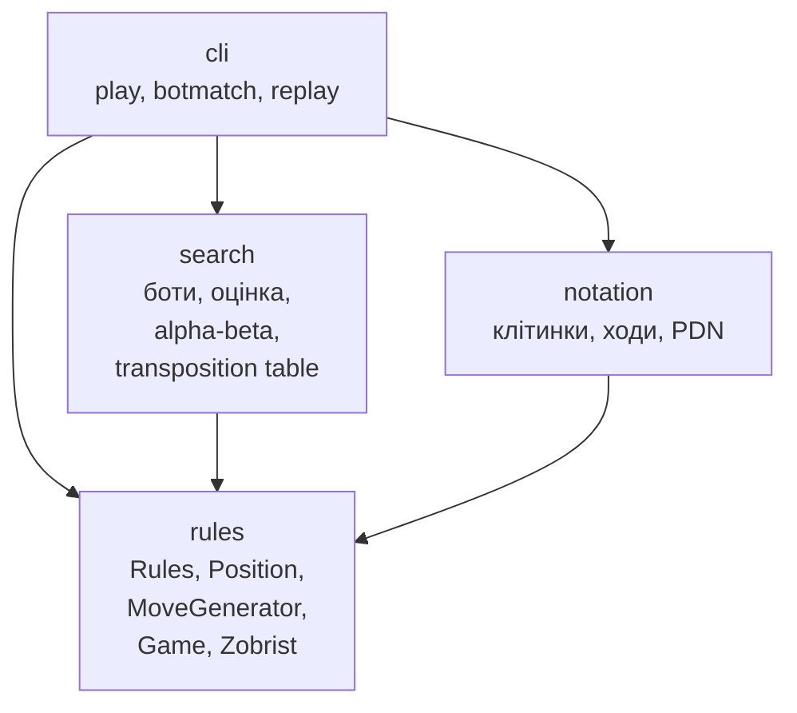
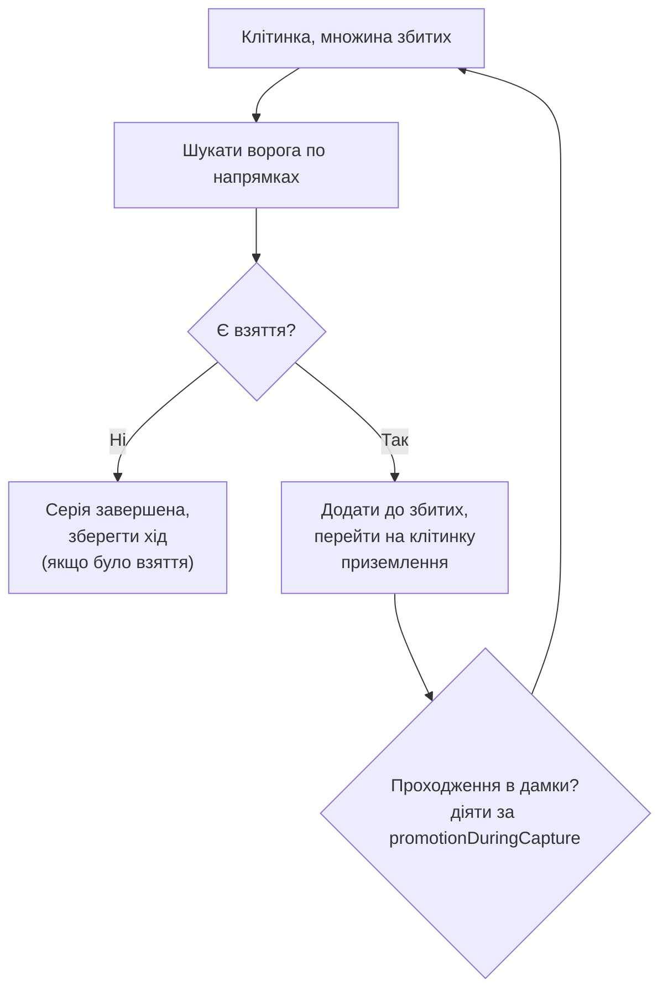

# Рушій шашок (Draughts Engine)

**Виконала:** Козаченко Софія Олександрівна, ІМ-43  
**Мова:** TypeScript

---

## Зміст

1. [Опис проєкту](#1-опис-проєкту)
2. [Специфікації та еталони](#2-специфікації-та-еталони)
3. [Правила, які реалізуються](#3-правила-які-реалізуються)
   - [3.1. Відмінності між варіантами](#31-відмінності-між-варіантами)
   - [3.2. Спільні нетривіальні правила](#32-спільні-нетривіальні-правила)
4. [Архітектура](#4-архітектура)
   - [4.1. Шари](#41-шари)
   - [4.2. Основні рішення](#42-основні-рішення)
5. [Публічне API](#5-публічне-api)
   - [5.1. Шар rules](#51-шар-rules)
   - [5.2. Шар search](#52-шар-search)
   - [5.3. Шар notation](#53-шар-notation)
   - [5.4. Помилки](#54-помилки)
6. [Ключові алгоритми](#6-ключові-алгоритми)
   - [6.1. Генератор ходів](#61-генератор-ходів)
   - [6.2. Пошук](#62-пошук)
7. [Нотація та CLI](#7-нотація-та-cli)
8. [Стратегія тестування](#8-стратегія-тестування)
   - [8.1. Unit-тести](#81-unit-тести)
   - [8.2. Property-based (fast-check)](#82-property-based-fast-check)
   - [8.3. Differential-тестування](#83-differential-тестування)
   - [8.4. Тести бота](#84-тести-бота)
   - [8.5. E2E](#85-e2e)
   - [8.6. Fuzz](#86-fuzz)
   - [8.7. Coverage та mutation testing](#87-coverage-та-mutation-testing)
   - [8.8. Performance-тести](#88-performance-тести)
9. [MVP та етапи](#9-mvp-та-етапи)
10. [Стек](#10-стек)

---

## 1. Опис проєкту

Бібліотека без UI, яка реалізує правила шашок і вміє грати. Вона складається з трьох частин:
- **Правила:** три варіанти (українські 8×8, англійські 8×8, міжнародні 10×10), що задаються конфігурацією: стан партії, генератор легальних ходів, застосування ходу, визначення перемоги та нічиї.
- **Нотація:** запис і читання ходів та партій у форматі PDN.
- **Бот:** програмний гравець, який за поточною позицією обирає хід.

Зверху є CLI для гри в консолі, гри бот проти бота та відтворення партій.

Є два типи ботів: випадковий (потрібен для генерації партій у тестах і як слабкий суперник) та бот на основі minimax з alpha-beta відсіканням. Пошук має кілька покращень: упорядкування ходів (спершу взяття, щоб alpha-beta відсікала більше), ітеративне поглиблення з лімітом часу та transposition table із Zobrist-ключами позицій. Бот працює лише через публічний інтерфейс правил і нічого не знає про внутрішнє зберігання дошки. Якість бота перевіряється тестами: він завжди повертає легальний хід, alpha-beta дає ту саму оцінку, що й звичайний minimax, а сильніша конфігурація виграє у слабшої в серії матчів.

**Що не входить у проєкт:** графічний інтерфейс, мережева гра, нейромережі та машинно-навчальні оцінки позиції.

**Ядро проєкту:** правила, нотація (включно з PDN) та бот із пошуком. До ядра не належать CLI, тести і допоміжні скрипти. Рядки рахуються інструментом cloc по модулях `rules`, `notation`, `search`.

---

## 2. Специфікації та еталони

- **Правила українських шашок:** офіційні правила Федерації шашок України
- **Правила англійських шашок:** WCDF
- **Правила міжнародних шашок:** FMJD
- **Формат PDN:** специфікація PDN 3.0

Правила є специфікацією для unit-тестів, а наївна реалізація генератора ходів є еталоном для differential-тестування.

---

## 3. Правила, які реалізуються

### 3.1. Відмінності між варіантами

| Властивість | Українські | Англійські | Міжнародні |
| :--- | :--- | :--- | :--- |
| **Дошка** | 8×8 | 8×8 | 10×10 |
| **Шашок у гравця** | 12 | 12 | 20 |
| **Перший хід** | білі | чорні | білі |
| **Проста шашка б'є назад** | так | ні | так |
| **Дамка** | летюча | крок на 1 клітинку | летюча |
| **Взяття обов'язкове** | так | так | так |
| **Вибір серії** | будь-яка, але до кінця | будь-яка, але до кінця | та, де з'їдено найбільше шашок |
| **Проста шашка досягла останнього ряду посеред серії** | стає дамкою й продовжує бити як дамка | стає дамкою, хід закінчується | не стає дамкою, якщо серія йде далі |
| **Нотація клітинок** | літера+цифра (a3) | номери 1–32 | номери 1–50 |

### 3.2. Спільні нетривіальні правила

- **Серія взять:** Після стрибка гравець зобов'язаний продовжити, якщо з нової клітинки є взяття.
- **Заборона повторного стрибка:** Одну шашку суперника не можна перестрибнути двічі за хід. Збиті шашки знімаються з дошки лише після завершення серії, тому до кінця ходу вони блокують шлях.
- **Летюча дамка:** Після стрибка вона може стати на будь-яку вільну клітинку за збитою шашкою. Якщо з деяких із цих клітинок можливе продовження серії, обирати треба серед них.
- **Нічия:**

| Умова | Українські | Англійські | Міжнародні |
| :--- | :--- | :--- | :--- |
| **Повторення позиції** | втретє, з тією самою стороною на ході | втретє, з тією самою стороною на ході | втретє, з тією самою стороною на ході |
| **Ходи дамками без взяття та без ходів простих шашок** | 15 ходів кожного | 40 ходів кожного | 25 ходів кожного |
| **Одна дамка проти кількох шашок** | 15 ходів проти однієї, 5 ходів проти двох або менше | відсутнє, тому діє правило 40 ходів | 16 ходів проти трьох шашок, 5 ходів проти двох або менше |

---

## 4. Архітектура

### 4.1. Шари

| Шар | Відповідальність | Залежить від |
| :--- | :--- | :--- |
| `cli` | команди, введення/виведення | `search`, `notation`, `rules` |
| `search` | боти, оцінка, пошук | лише публічний інтерфейс `rules` |
| `notation` | клітинки, ходи, PDN | `rules` (типи `Move`, `Position`) |
| `rules` | конфігурація, дошка, генератор ходів, статус гри, історія партії (`Game`) | нічого |

**Ключове обмеження:** Шар `search` не знає, як усередині `rules` збережена дошка. Він користується лише `legalMoves()`, `apply()`, `status()`, `turn`, `pieceAt()` та непрозорим ключем `key`. Тому внутрішнє представлення можна змінити без змін у пошуку.



### 4.2. Основні рішення

- **Параметризований генератор:** Правила варіанта описує об'єкт `Rules`, а генератор не містить жорстко прописаних правил конкретного варіанта. Гнучкість правил закладається в ядро від початку, навіть коли реалізований лише один варіант.
- **Дошка:** Масив клітинок лише по темних клітинках, з передрахованими таблицями сусідів для кожного розміру дошки. Бітові дошки не використовуються: три розміри та різні правила простіше підтримувати на масиві.
- **Position незмінна:** `apply()` не змінює поточну позицію, а повертає нову. Тому пошук просто переходить від однієї позиції до іншої й повертається до попередньої без скасування ходів, а це прибирає клас помилок, пов'язаних зі станом.
- **Історія партії:** `Position` описує лише поточний стан дошки і не зберігає, як до нього дійшли. Тому нічия за повторенням позиції визначається в `Game`, який зберігає `Position` разом з історією попередніх позицій. Лічильник ходів дамками без взяття не потребує історії: це число, яке `apply()` оновлює в новій позиції. Тому він зберігається в `Position`, і нічию за цим правилом бачить і пошук. Натомість пошук не бачить нічию за повторенням: бот працює з `Position`, яка історії не має, а таку нічию фіксує лише `Game`.

---

## 5. Публічне API

### 5.1. Шар rules

```typescript
type Color = 'white' | 'black';
type Square = number;
type Piece = { color: Color; kind: 'man' | 'king' };

interface DrawRules {
  repetitionCount: number;
  kingMovesWithoutCaptureLimit: number;
}

interface Rules {
  id: 'ukrainian' | 'english' | 'international';
  boardSize: 8 | 10;
  firstMover: Color;
  menCaptureBackward: boolean;
  kingsFly: boolean;
  captureChoice: 'any' | 'maximum';
  promotionDuringCapture:
    | 'continue-as-king'
    | 'ends-move'
    | 'stay-man-if-continues';
  draw: DrawRules;
}

interface Move {
  from: Square;
  path: Square[];
  captured: Square[];
  promotes: boolean;
}

type GameStatus =
  | { kind: 'ongoing' }
  | { kind: 'win'; winner: Color }
  | { kind: 'draw'; reason: string };

interface Position {
  readonly rules: Rules;
  readonly turn: Color;
  readonly key: bigint;
  pieceAt(sq: Square): Piece | null;
  legalMoves(): Move[];
  apply(move: Move): Position;
  status(): GameStatus;
}

function createInitialPosition(rules: Rules): Position;

class Game {
  readonly position: Position;
  play(move: Move): void;
  status(): GameStatus;
}
```

### 5.2. Шар search

```typescript
interface Bot {
  chooseMove(position: Position): Move;
}
```

- `RandomBot(seed)`
- `MinimaxBot({ depth })` — alpha-beta з упорядкуванням ходів
- `IterativeBot({ timeMs })` — ітеративне поглиблення, transposition table

### 5.3. Шар notation

```typescript
interface PdnGame {
  headers: Record<string, string>;
  moves: string[];
}

function parseMove(text: string, position: Position): Move;
function formatMove(move: Move, rules: Rules): string;
function parsePdn(text: string): PdnGame;
function formatPdn(game: PdnGame): string;
```

### 5.4. Помилки

- `IllegalMoveError`: у `apply()` передано хід, якого немає серед легальних.
- `ParseError`: некоректний текст у `parseMove` або `parsePdn`.

---

## 6. Ключові алгоритми

### 6.1. Генератор ходів

1. Для кожної шашки гравця шукаємо взяття рекурсивно. Стан пошуку: поточна клітинка, тип шашки, множина збитих шашок. Збиті шашки не знімаються до кінця серії.
2. Якщо взяття знайдені, повертаються тільки взяття. Для `captureChoice: 'maximum'` додатково лишаються лише серії з найбільшою кількістю збитих.
3. Якщо взяттів немає, генеруються тихі ходи.
4. Проходження в дамки посеред серії обробляється за `promotionDuringCapture`.



### 6.2. Пошук

- **Базовий рівень:** бот використовує minimax з alpha-beta, оцінка за матеріалом (дамка ≈ 3 прості шашки).
- **Покращення:** упорядкування ходів, ітеративне поглиблення з лімітом часу, transposition table із Zobrist-ключем.

---

## 7. Нотація та CLI

- **Нотація:** Внутрішні клітинки перетворюються на запис варіанта (літера+цифра або номер). Хід-взяття записується через `:` у літерній нотації (`a3:c5:e7`) та через `x` у номерній (наприклад, `22x15`), тихий хід — через `-`.
- **PDN:** Заголовки (`[White "..."]`, `[Result "..."]`), список ходів, коментарі. Вкладені варіанти не підтримуються. Помилки розбору повертають `ParseError` з номером рядка й позицією.

| Команда | Що робить |
| :--- | :--- |
| `play --rules ukrainian --white human --black minimax:4` | гра в консолі |
| `botmatch --rules ukrainian --white minimax:4 --black random --seed 1` | гра бот проти бота |
| `replay <файл>` | відтворення партії з файлу крок за кроком, зупинка з помилкою на нелегальному ході |

---

## 8. Стратегія тестування

### 8.1. Unit-тести
Кожне правило окремо на вручну складених позиціях, з очікуваним набором ходів, виписаним за правилами: обов'язкове взяття, взяття назад, серія, заборона повторного стрибка, летюча дамка, три варіанти проходження в дамки, максимальне взяття, кожна умова нічиї, парсери.

### 8.2. Property-based (fast-check)
Позиції генеруються як досяжні: `fast-check` генерує послідовність чисел, кожне число обирає індекс легального ходу з поточної позиції. Так позиції завжди досяжні й добре зменшуються при знаходженні контрприкладу. Усі властивості запускаються для кожного варіанта правил.
- **Серія не обривається:** Після ходу-взяття від кінцевої клітинки шашки немає продовження взяття. Виняток: правило `ends-move` в англійських шашках, де хід закінчується проходженням у дамки.
- **Немає повторного взяття:** У списку `captured` кожного легального ходу немає дублікатів.
- **Дзеркальна симетрія:** Поворот дошки на 180° зі зміною кольорів дає дзеркальний набір ходів. Це ловить помилки, що залежать від напрямку.
- **Швидкий генератор збігається з еталоном:** множини ходів основного та наївного генераторів однакові на досяжних позиціях.

### 8.3. Differential-тестування
Еталонний генератор ходів є частиною тестового коду і написаний окремо від основного: двовимірна дошка з координатами, без передрахованих таблиць, прості рекурсивні функції. Він не використовує код модуля `rules`, щоб однакова помилка в обох реалізаціях була малоймовірною. До підрахунку ядра він не входить.

### 8.4. Тести бота
- Бот перевіряється на всіх трьох варіантах правил, лише через публічний інтерфейс `Position`.
- Хід, який повертають `RandomBot`, `MinimaxBot` та `IterativeBot`, завжди належить `legalMoves()`.
- Alpha-beta дає ту саму оцінку позиції, що й звичайний minimax без відсікання. Цей еталонний minimax є допоміжною реалізацією в тестовому коді і до підрахунку ядра не входить.
- `RandomBot` з однаковим seed вибирає однакові ходи.
- Бот із більшою глибиною виграє у слабшого в серії партій із фіксованим seed (поріг за очками, а не «завжди»).

### 8.5. E2E
Усі публічні функції API покриті сценаріями «зверху вниз»:
- Повні партії через API для кожного варіанта правил: PDN-файли з відомим результатом і кількістю ходів.
- Бот проти бота з фіксованим seed: партія завершується, кінцевий статус коректний.
- `replay` на валідних і невалідних файлах партій.
- CLI запускається як окремий процес, вхід через stdin, перевірка stdout та коду завершення.

### 8.6. Fuzz
Довільні рядки у `parseMove`, `parsePdn` і командному рядку CLI. Очікування: або коректний результат, або `ParseError`, ніколи інший виняток чи зависання.

### 8.7. Coverage та mutation testing
- **Coverage:** `vitest` (v8), ціль $\ge 85\%$ branch по ядру.
- **Mutation testing:** StrykerJS з vitest-runner. Мутації застосовуються лише до ядра (модулі `rules`, `notation`, `search`), а не до CLI та тестів. Ціль: mutation score не менше $80\%$. Для швидкості використовується аналіз покриття по тестах та інкрементальний режим.

### 8.8. Performance-тести
- **Perft генератора ходів:** Рахується кількість досяжних позицій на глибині $N$ від початкової. Результат порівнюється з наївним еталонним генератором.
- **Пропускна здатність:** Скільки позицій на секунду генерує та застосовує ядро (`legalMoves` + `apply`), окремо для 8×8 і 10×10.
- **Час пошуку на фіксованій глибині:** `MinimaxBot` на глибинах 2–6 з фіксованим набором позицій.
- **Ефект оптимізацій:** Пошук із впорядкуванням ходів і transposition table переглядає помітно менше вузлів, ніж без них, на тих самих позиціях і з тією самою оцінкою.

---

## 9. MVP та етапи

- **MVP:** українські правила 8×8 через параметризований `Rules`, генератор ходів з усіма правилами взяття, `apply`, дамки, статус гри та нічиї, власна проста нотація ходів із записом і читанням партії, `RandomBot` і minimax з alpha-beta, CLI (`play`, `botmatch`, `replay`), unit-тести, чотири property-тести, e2e, performance-тести, coverage і Stryker.
- **Після MVP:** реалізується решта запланованого обсягу у такому порядку: англійські правила, міжнародні правила, формат PDN, сильніший бот (упорядкування ходів, ітеративне поглиблення, transposition table). Якщо обсягу ядра виявиться недостатньо, додається резерв: турнірний режим, quiescence search і розширена оцінка позиції.

Кожен етап завершується власними тестами, а не відкладає їх на кінець.

---

## 10. Стек

- TypeScript
- Node.js
- vitest (з @vitest/coverage-v8)
- fast-check
- StrykerJS
- cloc

